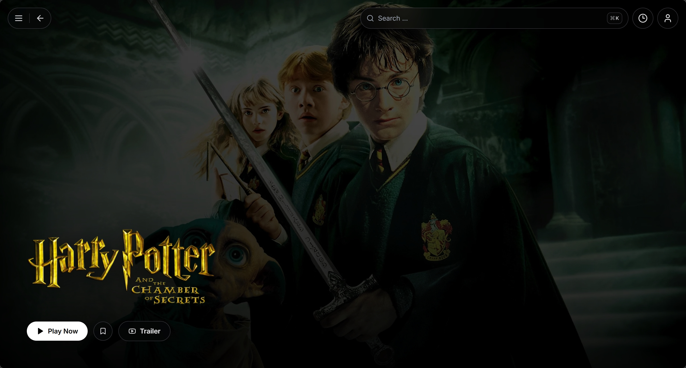
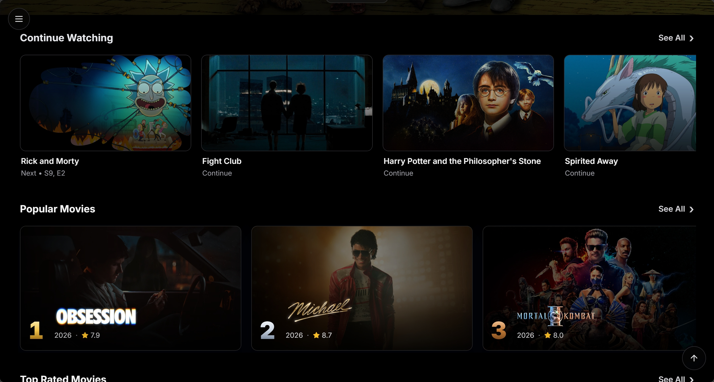
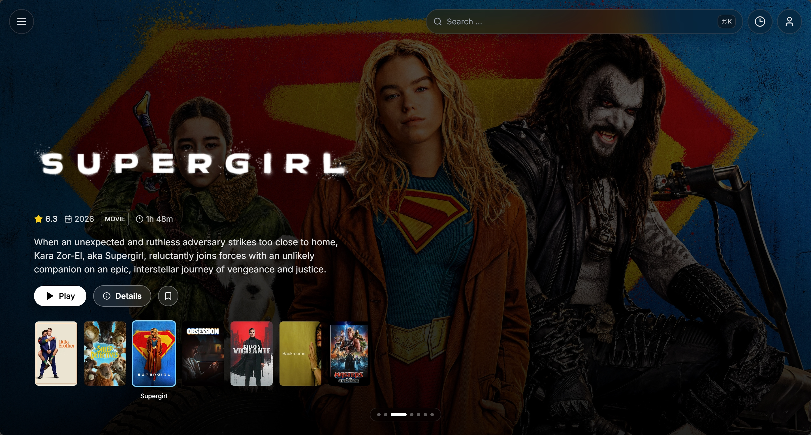

# Lumi

<div align="center">
  
</div>

<p align="center">
  <a href="README.md">English</a> · 中文
</p>

> **Lumi** 是一款使用 **Next.js 15**、**Tailwind CSS** 和 **TypeScript** 构建的跨平台电影与剧集发现应用。名称灵感来自卢米埃尔兄弟和电影早期的公开放映。

<div align="center">


</div>

---

## 功能特性

- 🔎 **多源搜索**：跨已配置的内容源搜索，并在一个地方汇总结果。
- 🎬 **TMDB 元数据增强**：支持海报、背景图、评分、演员、合集和推荐内容。
- 🌐 **多语言界面**：支持英文和中文切换，TMDB 请求会跟随当前语言。
- 🧠 **个性化推荐引擎**：基于观看历史生成发现栏目，结合 TMDB 推荐、相似标题、关键词、演职员和排序信号。
- 🍿 **电影和剧集发现**：浏览电影、剧集、精选分类、年份、评分和片长筛选。
- ⭐ **收藏和继续观看**：保存收藏、观看历史、播放进度和续看位置。
- 🗄️ **灵活的服务端存储**：支持 localStorage、Redis、Cloudflare D1 和 Upstash Redis。
- 🔒 **无需账号**：无需登录或注册；收藏、观看历史和播放进度保存在当前浏览器中。
- 📱 **PWA 就绪**：支持离线缓存、添加到主屏幕和移动端友好的体验。
- 🖥️ **响应式布局**：桌面侧边栏、移动端底部导航和大屏内容栏。

## 截图

<p align="center">
  
</p>
<p align="center">
  
</p>
<p align="center">
  
</p>

## 快速开始

```bash
pnpm install
pnpm dev
```

开发服务器默认运行在 `http://localhost:3000`。

## 部署

Docker、Vercel、Cloudflare Workers、存储后端和环境变量相关说明请查看 [DEPLOYMENT.md](DEPLOYMENT.md)。

## 技术栈

| 领域             | 主要依赖                                                                  |
| ---------------- | ------------------------------------------------------------------------- |
| 框架             | [Next.js 15](https://nextjs.org/) App Router                              |
| UI 和样式        | [Tailwind CSS 3](https://tailwindcss.com/)、next-themes、Framer Motion    |
| 语言             | TypeScript 5                                                              |
| 数据和存储       | localStorage、Redis、Cloudflare D1、Upstash Redis                         |
| 个人数据         | 使用浏览器 localStorage 保存收藏、搜索历史和观看进度                      |
| 内容增强         | TMDB API、分类内容源、图片代理                                            |
| 代码质量         | ESLint、Prettier、Jest                                                    |
| 部署             | Docker、Vercel、Cloudflare Workers、OpenNext                              |

## 许可证

[Apache-2.0](LICENSE) (c) 2026 Lumi Contributors

## 开发者

[Bit](https://t.me/decimalvalue) — Telegram：[@decimalvalue](https://t.me/decimalvalue)

## 致谢


- [Next.js](https://nextjs.org/) 和 [Tailwind CSS](https://tailwindcss.com/)：应用框架和样式基础。
- 感谢开源项目、元数据服务和内容源 API 的维护者，是它们让这个项目成为可能。
